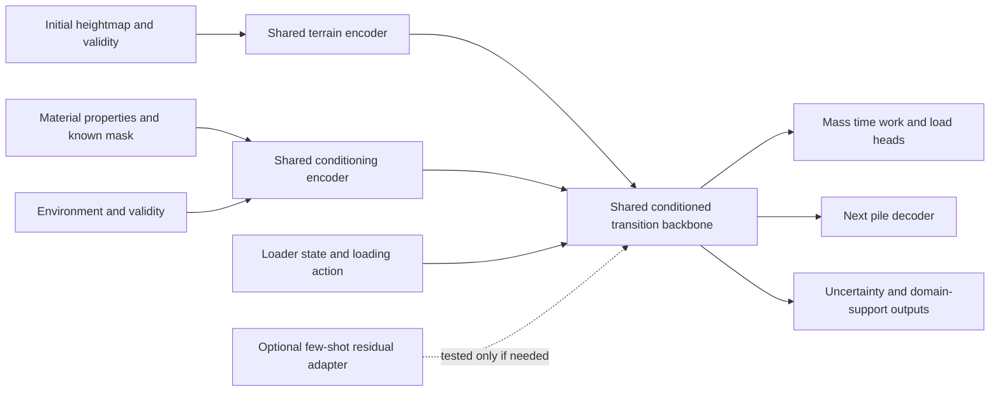

# Material-general modeling strategy

Status: configuration/data-boundary infrastructure plus a proposed architecture.
No new granular simulator, world model, trained policy or cross-material result.
Existing MuJoCo M2, v0/v1 assets and backend experiments are preserved.

## Separate four kinds of information

| Record | Meaning | Where / status |
|---|---|---|
| Physical material | Sample density, grading, shape, friction/strength, environment, measurement provenance | `configs/terrain/materials/v1/*.yaml`; loader implemented |
| Numerical resolution | DEM element diameters, continuous terrain grid, active-zone particles, physics/control periods | `configs/terrain/resolutions/m2_reference.yaml`; validator implemented |
| Backend calibration | Contact law, stiffness/damping convention, rolling/torsional law, solver settings and calibration dataset | Existing experiment YAML retained; no generic cross-backend mapping implemented |
| Transition / experiment provenance | Initial state, material and numerical hashes, controller/action/vehicle revisions, outputs and validity | Proposed below; no dataset exporter/trainer implemented |

Changing numerical resolution must not mutate the intended physical material.
It may require **recalibrating the numerical contact law**, and results may change.
Separate material and resolution hashes expose this; they do not guarantee
resolution-independent mechanics. Changing physical PSD is a different experiment.

## Material schema v1

Implemented in `terrain/materials.py`, independent of ROS/Isaac/MuJoCo imports.
Each material has `schema_version`, `material_id`, description and three groups:

- **Bulk:** bulk/particle density, packing fraction, internal friction angle,
  cohesion, dilatancy angle, bulk/shear strength and Young modulus.
- **Particle:** physical PSD D10/D50/D90 and weighting basis, shape/angularity
  description, particle/particle and particle/bucket friction, rolling resistance,
  restitution, effective contact stiffness/damping.
- **Environment:** moisture (water mass / total wet mass), temperature when relevant.

Each property has exactly these fields:

```yaml
value: null
unit: kg/m^3
status: unknown
source: 'unknown: sample-specific measurement required'
calibration_dataset: null
notes: 'Sample preparation, scope, uncertainty and interpretation belong here.'
```

- `unknown` means null, never zero. Known values require finite numeric values or
  categorical text, explicit units and source/interpretation. Angles use radians.
- Status: `unknown`, `reported`, `measured`, `estimated`, `calibrated`, `derived`,
  `assumed`. A reported simulator assignment is not a measured material constant.
  Calibrated entries require a dataset reference; dataset access/validation is a
  separate check. Uncertainty is unquantified unless stated in the source/notes.
- PSD percentiles require a declared mass/volume/number weighting basis before
  use. A physical description of 30–40 mm plus fines does not determine D10/D50/D90.
- Packing is bulk/solid density **for compatible preparation and moisture basis**.
  The validator checks the recorded ratio when all three values are supplied.
  A ratio inferred using assigned solid density remains a conditional estimate.
- Shear strength is stress/state dependent, not generally one transferable scalar.
  Strength entries require confining stress, preparation and failure criterion in
  their source/notes. Friction and dilatancy require matched shear-test conditions.
- Effective linear contact stiffness/damping use N/m and N*s/m. Hertz parameters,
  Young modulus, MuJoCo contact softness and solver damping are different quantities.
- Physical rolling resistance uses an explicitly defined equivalent length [m]:
  resisting rolling torque divided by normal force, under stated particle geometry,
  preload and speed. It is unknown in these profiles. Dimensionless or differently
  normalized backend coefficients belong to their versioned laws and cannot be
  pasted into this field; the loader rejects those unit mismatches. This observable
  still requires calibration to a chosen numerical rolling/contact law.
- The CLI and `require_values` validate availability/consistency only. They do not
  certify physical validity, select a solver or enable a production terrain backend.

Initial profiles:

- `aoshima_reference_gravel`: measured field bulk density; reported/model-assigned
  solid density and bulk angles/modulus; conditional packing ratio; idealized zero
  cohesion explicitly marked assumed. Physical friction/rolling/contact/PSD
  percentiles and quantitative moisture remain unknown. See the
  [source audit](aoshima_reproduction.md) for AGX-specific numerical coefficients.
- `dry_sand`: no invented densities, grading or contact values. Identify a specific
  sample and calibration protocol before enabling material simulation.
- `dry_coal`: loose dry stockpile candidate, not bonded coal-rock fracture. Coal
  rank, fragmentation, porosity, density, fines and shape need sample-specific data.

Dry/non-cohesive is the initial **study scope**, not evidence that an arbitrary
field sample has zero moisture/cohesion. Wet/cohesive material needs an explicit
new scope/contact law; it is not a coefficient switch in this diagnostic model.

```bash
PYTHONPATH=src .venv/bin/python scripts/check_material_profiles.py --resolution configs/terrain/resolutions/m2_reference.yaml
PYTEST_DISABLE_PLUGIN_AUTOLOAD=1 .venv/bin/python -m pytest -q tests/unit/test_material_profiles.py
```

Legacy null material YAML and current M2 settings are untouched. These new profiles
are not silently consumed by existing column/blade/scoop runs. A future adapter must
explicitly select material + resolution + calibrated backend law, record their
hashes, reject missing required properties and validate that exact combination.

## Calibration and multiscale feasibility

Use the existing column, heap/surface, blade-force and M2 accounting tools before
building new terrain infrastructure. See [material benchmarks](../benchmarks/MATERIALS.md).

- Fit bulk density/packing, static and dynamic repose/flow, wall/steel friction,
  and shear behavior jointly. Repose alone cannot identify multiple contact
  parameters; contact friction, rolling resistance and shape can compensate.
- Separate calibration samples from held-out material/tool tests. Record force
  sensor uncertainty, grading/moisture, preparation and apparatus geometry.
- Validate penetration force versus displacement, net and positive actuator work,
  retained mass/spillage and final surveyed pile shape. Retain complete ID/boundary
  accounting; for continuous/particle transfer conserve mass and audit momentum.
- Check timestep/iteration/collision convergence **before** fitting physical data.
  Re-run calibration applicability at each coarsening; preserve held-out tests.
- Do not claim all material parameters independently measurable or identifiable.
  Distinguish physical observations from effective law parameters fitted to them.

Aoshima G-model reproduction needs an occupied/compacted continuous terrain,
predicted active wedge, local DEM, aggregate inertia/momentum, coupled reactions,
penetration resistance and conservative particle/continuum conversion. None of
that vehicle/material coupling is currently implemented here. A small G200 particle
count does not justify replacing our 83 free spheres by a 480-particle simulation.

Newton MPM is a different constitutive/coupling approach, not an automatic G-model
implementation. PhysX particles or rigid bodies likewise need force/bulk calibration.
Keep backend selection open while resolving [current parity failures](../experiments/PHYSICS_BACKEND_BENCHMARK.md).
A multiscale prototype is justified only after a bounded, independently validated
material/tool reference and an explicit coupling/conservation acceptance test.

## Proposed shared world-model interface

**Proposal only.** This is a cycle-level surrogate, not an actuator simulator.
No network/weights/training entry point is added. Fit shared material conditioning
only after repeatable material/digging references pass; PPO remains unavailable.
The existing active-system gate on learned models remains in effect.

A future in-process interface is `predict(batch) -> prediction`, with batch-first
float32 tensors on one device. No ROS transport or per-environment CPU conversion
in its eventual training/inference path. Config loading/fingerprinting happens
once outside the hot path. Owned observations must not alias mutable simulator state.

| Input | Shape / semantics |
|---|---|
| Initial local heightmap + validity | `[B,H,W]` metres + bool; fixed metric grid, surveyed baseline and world transform |
| Material descriptor + known mask | `[B,M]` SI features + bool; fixed ordered feature/unit manifest, statuses and uncertainty retained in metadata |
| Loader state + validity | `[B,S]`; named chassis pose/twist, articulation, cylinder positions/velocities, initial payload; exact feature/unit manifest |
| Loading action | `[B,A]`; versioned controller parameters, not bucket angle or an unversioned latent code |
| Environment + known mask | `[B,E]`; moisture, optional temperature; unknown is not dry/zero |
| Optional mixture state | `[B,K]` constituent mass fractions initially; composition/segregation fields when homogeneous mixing is insufficient |

- Local frame: +X attack direction, +Y left, +Z gravity-up. Persist `world_T_local`,
  grid origin/cell spacing, survey datum, sample times and masks. Heightmaps alone
  may not encode packing, segregation or history; this is a partial-observation
  model, not an assumed Markov state.
- Use existing M2's approach speed, attack angle, penetration depth/speed, curl/lift
  cylinder velocities, breakout threshold and reverse distance as an initial action
  schema. Persist all other fixed controller settings and revision. The paper's
  four force-feedback parameters are a different controller; do not equate them.
  Convert the existing YAML attack-angle degrees to radians at this boundary;
  preserve the original config and controller schema in provenance.
- Begin with existing exact diagnostic loader state and explicitly labelled
  privileged terrain information. Sensor-based observations are a separate dataset
  variant with noise, occlusion, delay and availability masks.
- Convert configuration records into fixed numeric descriptors once. Store unknown
  values as null/NaN plus masks; a future network preprocessor may fill masked
  entries with a neutral normalized value **only alongside the mask**. Fit all
  normalization on training data. Unknown values must not become measured zeros.

| Output | Shape / semantics |
|---|---|
| Final retained/loaded mass | `[B,1]` kg at a declared stabilized end event; acquisition and spillage separate |
| Loading time | `[B,1]` s between declared phase events |
| Mechanical work | `[B,2]` J: signed net work and positive actuator work, with separate validity |
| Loads | `[B,F]` named forces [N]/torques [Nm], defined peaks or time-profile summaries |
| Next pile + validity | `[B,H,W]` metres in the same metric frame |
| Uncertainty / OOD flag | Per-target uncertainty and domain-support flag; not an accuracy certificate |

Mechanical work is integrated measured physical force × cylinder velocity and
wheel torque × angular velocity with declared windows/sign convention. Never label
this fuel or battery consumption. If existing logs lack valid effort/velocity
samples, those targets remain unavailable until instrumentation is implemented.

### Proposed data record

- `transition_id`, `rollout_group_id`, seed, material lot/property-combination ID,
  source/next pile IDs; disjoint calibration/train/validation/test assignment.
- Material and numerical fingerprints, backend/law/version, calibration dataset,
  vehicle model/hash, controller/action schema/hash, control/measurement rates.
- Initial loader/pile state and frame/grid metadata; action; measured targets,
  validity/uncertainty, failed-step/solver/contact-capacity/conservation gates.
- Whole-body/particle or continuous-state references for physical audits. A heightmap
  cannot replace the mass ledger, overhang geometry or retained/spilled material.
- Keep numerical metadata for stratification and debugging. Do not use resolution
  as a physical-material feature that conceals a backend's bias. A nuisance-resolution
  conditioning ablation may be tested separately against held-out physical targets.

### Shared architecture (not implemented)



Compare continuous-property concatenation and feature-wise conditioning first.
Material-ID embeddings are an ablation: an unseen coal ID has no learned embedding,
so an ID-only model cannot demonstrate property-based zero-shot transfer. Optional
material-specific residual heads must be regularized/tested against one shared head;
add them only when held-out evidence shows a need. Few-shot adaptation can freeze
terrain encoding and adapt a small conditioner/head, compared with full fine-tuning
and training from scratch at identical target-data budgets. Keep a single shared
backbone unless the experiments justify a separate material model.

Mixtures need constituent identities, grading and mass fractions, plus composition
fields if segregation matters. Averaging sand/coal density and friction is not an
established mixture constitutive model. Architecture support is not simulator support.

Validation for this change: 165 core tests pass, including 13 material/resolution
checks. Existing M2 source/config/assets are unchanged; no new physics run or model
training was performed. Source-paper claims remain separate from repository results.
